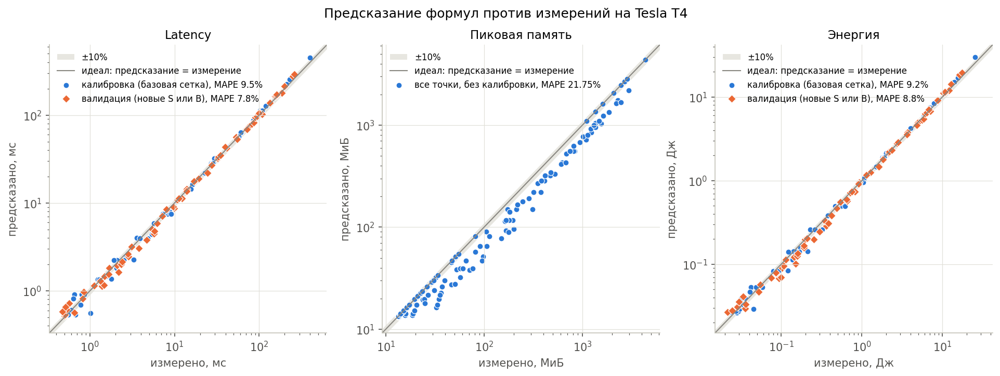
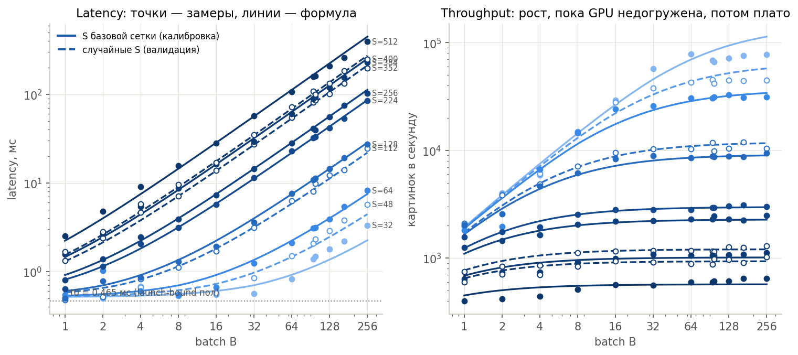
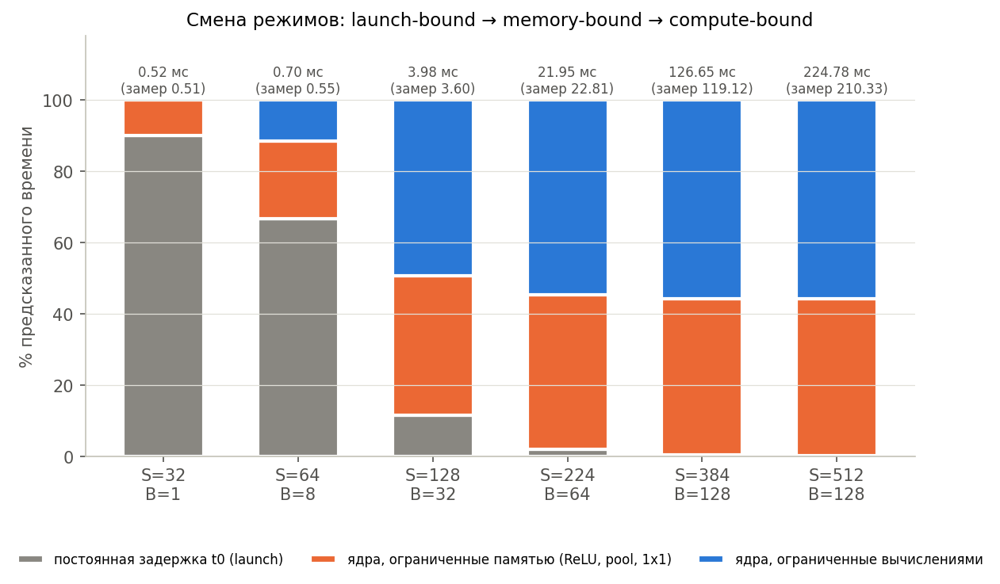
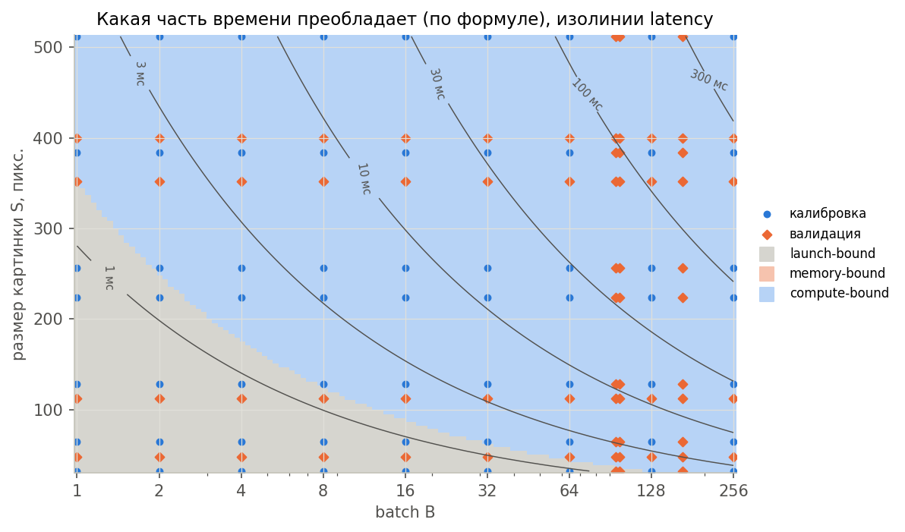
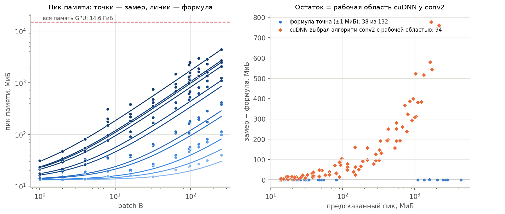
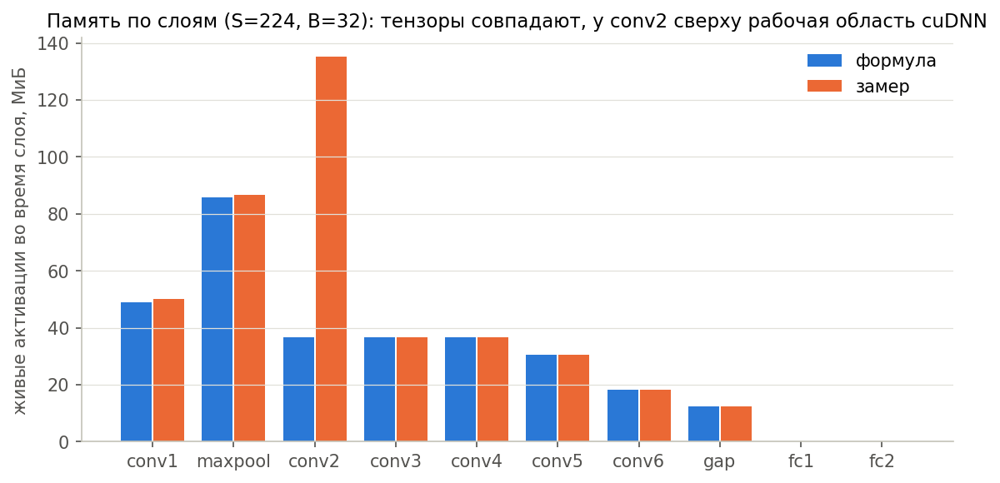
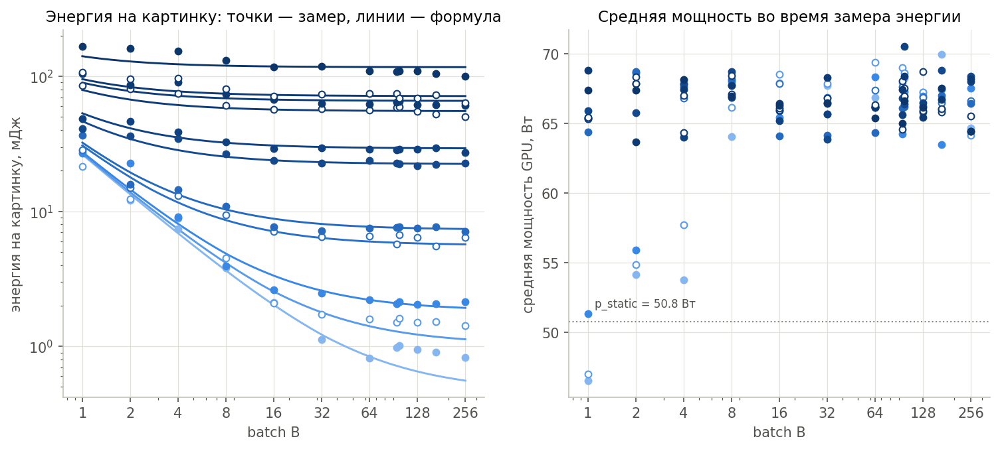
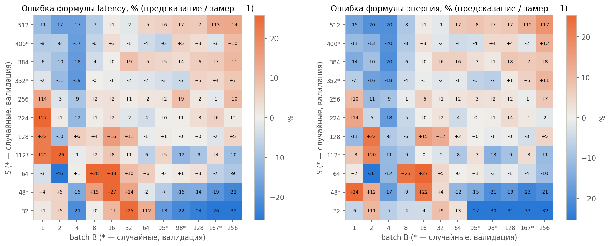
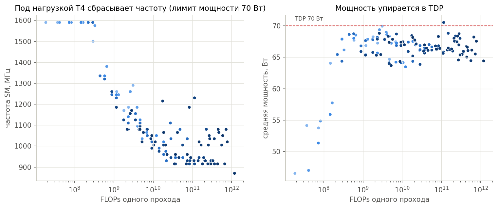

# ДЗ-1: аналитическая модель стоимости маленькой CNN

Курс Efficient Models, ИТМО 2026. Карина Денисова.

Для сети из задания (6 свёрток без residual, голова GAP + 2 Linear) выведены четыре формулы от размера картинки S и батча B. Затем сеть измерена на GPU, параметры latency и energy подобраны на базовой сетке и проверены на точках, которых модель не видела.

| Функция | Формула | Подбор |
|---|---|---|
| `flops(S, B)` | 17 712 · B · S² + 313 344 · B | нет |
| `memory(S, B)` | 4 161 536 + R + 68 · B · S² байт, R — рабочая область cuBLAS (константа, измеряется один раз) | **нет, считается точно** |
| `latency(S, B, θ)` | t0 + Σ по 17 ядрам max(FLOPs_k / P, Bytes_k / BW) | θ = (t0, P, BW) |
| `energy(S, B, θ_E)` | p_static · Latency + e_flop · FLOPs + e_byte · Bytes | θ_E = (p_static, e_flop, e_byte) |

Вывод формул: [`hw1_handwritten.pdf`](hw1_handwritten.pdf). Набранная версия того же вывода: [`derivations.md`](derivations.md).

## Почему память не предсказывается, а считается

Размеры всех тензоров известны заранее, а порядок их выделения и освобождения задаёт код (`nn.Sequential`: во время слоя живы его вход и выход, ReLU inplace ничего не выделяет, MaxPool на CUDA временно держит индексы int64). Пик всегда на MaxPool: `a1 + a2 + индексы = 56 · B · S²` байт, плюс вход `12 · B · S²`, плюс веса. Подбирать здесь нечего. Отдельно измеряется только рабочая область cuBLAS: это постоянная добавка библиотеки, она не зависит от S и B. `measure.py` дополнительно проходит сеть слой за слоем и сравнивает живую память на каждом слое с формулой (`results/memory_audit.csv`, рисунок 07).

## Разбиение на калибровку и проверку

- **Калибровка:** только базовая сетка, S ∈ {32, 64, 128, 224, 256, 384, 512} × B ∈ {1, 2, 4, …, 256}, 63 точки.
- **Валидация:** все конфигурации, где S или B случайные (4 случайных S и 3 случайных B, seed 2026), 69 точек. При подборе θ они не используются.
- Ошибки в `results/theta.json` считаются отдельно для калибровки и для валидации.

## Как воспроизвести

Проще всего открыть [`hw1_colab.ipynb`](hw1_colab.ipynb) в Google Colab, выбрать T4 GPU и нажать Run all (≈ 10–15 минут). Ноутбук сам пишет код, делает замеры, калибровку и графики, а в конце скачивает `results.zip`.

Или вручную на машине с NVIDIA GPU:

```bash
pip install torch numpy matplotlib nvidia-ml-py
python measure.py     # замеры -> results/measurements.csv, runtime.json, memory_audit.csv
python calibrate.py   # подбор theta на базовой сетке -> results/theta.json, predictions.csv
python plots.py       # графики -> results/figures/
```

| Файл | Что внутри |
|---|---|
| `models.py` | сеть |
| `equations.py` | `flops()`, `memory()`, `latency()`, `energy()` и `bytes_moved()`, принимают numpy-массивы |
| `measure.py` | замеры: медиана latency по CUDA events, пик `max_memory_allocated`, энергия по счётчику NVML, OOM |
| `calibrate.py` | подбор θ (только numpy), метрики на калибровке и валидации |
| `plots.py` | графики, на каждом замеры и предсказание вместе |
| `results/measurements.csv` | S, B, latency, память или OOM, энергия, is_validation |
| `results/theta.json` | θ, θ_E и ошибки |

## Окружение

| | |
|---|---|
| GPU | Tesla T4, 15 ГБ (14,6 ГиБ доступно PyTorch), Google Colab |
| PyTorch / CUDA / cuDNN | 2.11.0+cu130 / 13.0 / 9.27 |
| Python | 3.13 |
| Флаги | `cudnn.benchmark = False`, TF32 выключен, `eval()` + `inference_mode()`, FP32 |

## Результаты

132 конфигурации (11 S × 12 B), OOM нет. Калибровка на 63 точках базовой сетки, проверка на 69 точках со случайными S ∈ {48, 112, 352, 400} или B ∈ {95, 98, 167}.

| | Калибровка | Валидация |
|---|---|---|
| Latency, MAPE (медиана) | 9,5% (6,3%) | 7,8% (5,5%) |
| Energy, MAPE (медиана) | 9,2% (7,1%) | 8,8% (6,8%) |

| Параметр | Значение | Смысл |
|---|---|---|
| t0 | 0,465 мс | постоянная задержка: запуск 17 ядер, Python, синхронизация |
| P | 4,46 TFLOP/s | достижимая скорость свёрток (P ≤ 8,14 по паспорту T4) |
| BW | 87 ГБ/с | эффективная пропускная способность (BW ≤ 320 по паспорту) |
| p_static | 50,8 Вт | мощность GPU, пока она занята |
| e_flop | 6,0 пДж/FLOP | |
| e_byte | 0 | неотличим от p_static, см. обсуждение |

**FLOPs:** формула совпала с независимым счётчиком `torch.utils.flop_counter.FlopCounterMode` во всех 4 проверочных точках.

**Память:**
- Веса: замер 4 161 536 байт, формула 4 161 536 байт.
- Всё, что живёт до прохода (веса + вход + рабочая область cuBLAS 9,125 МиБ), совпадает с формулой с точностью до 1 МиБ во всех 132 точках.
- Пик: в 38 точках из 132 формула точна (±1 МиБ). В остальных 94 замер больше на рабочую область cuDNN у conv2, до 777 МиБ (рисунки 06 и 07).
- OOM: предсказан не был и не случился. Максимум 4,26 ГиБ при S = 512, B = 256, всего доступно 14,6 ГиБ.











## Обсуждение

**Три режима.** При малых B · S² (S = 32 до B ≈ 100, S = 128 до B = 4, S = 224 до B = 2) время почти не зависит от B и держится около t0 ≈ 0,5 мс. GPU простаивает, а время уходит на запуск 17 ядер и Python. Это **launch-bound**: throughput растёт линейно с B (рисунок 02, справа). Дальше доля ядер, ограниченных памятью, растёт: ReLU, maxpool и GAP читают и пишут 232 из 380 байт трафика на B · S² и не делают полезных FLOPs. При больших B · S² время ∝ B · S², throughput выходит на плато, и доминируют свёртки conv2 (5×5) и conv5 (3×3, 256 каналов), это **compute-bound**. Переход виден на рисунках 04 и 05.

**Почему P и BW пришлось ограничить.** У всех слоёв и FLOPs, и байты растут одинаково, ∝ B · S². Поэтому по замерам на сетке (S, B) нельзя различить, что медленнее, вычисления или память. Без ограничений находятся два минимума с одинаковой ошибкой: P = 4,5 TFLOP/s при BW = 87 ГБ/с и P = 13 TFLOP/s при BW = 58 ГБ/с. Второй физически невозможен, потому что пик T4 в FP32 равен 8,1 TFLOP/s. Поэтому P и BW ограничены паспортом GPU. Эффективная BW = 87 ГБ/с ниже паспортных 320 ГБ/с, потому что в неё «стекает» всё, что формула не видит: неидеальный доступ к памяти свёрток и накладные расходы отдельных ядер. Чтобы честно разделить P и BW, нужны замеры отдельных слоёв, а не всей сети.

**Троттлинг.** Под нагрузкой T4 упирается в лимит мощности 70 Вт и сбрасывает частоту SM с 1590 до 870–1050 МГц (рисунок 10). На частоте около 1 ГГц пик FP32 равен 2560 ядер · 2 · 1 ГГц ≈ 5,1 TFLOP/s, и подобранное P = 4,46 TFLOP/s — это около 87% от него. Значит, свёртки cuDNN почти упираются в железо, а большой разрыв с паспортными 8,1 TFLOP/s объясняется частотой, а не плохими ядрами.

**Где формулы ломаются и почему.**
- *Алгоритм cuDNN.* С `benchmark = False` cuDNN выбирает алгоритм свёртки по эвристике, отдельно для каждой формы входа. Это видно сразу в двух местах. Во-первых, память: для conv2 при B ≥ 8 часто выбирается алгоритм с рабочей областью около 56–70 байт на B · S² (до 1,8 ГиБ при S = 512, B = 128). Тогда пик переезжает с maxpool на conv2, и формула недосчитывает. При B ≤ 4 и при самых больших конфигурациях (S ≥ 256, B = 256 или 167) выбирается алгоритм без рабочей области, и формула точна до байта. Во-вторых, latency: при B = 4 и больших S замер стабильно на 9–19% медленнее формулы, то есть на этих формах эвристика выбирает более медленный алгоритм. Это не случайный шум, а смена ядра.
- *Маленькие картинки, большие батчи* (S = 32–48, B ≥ 95): замер на 7–32% медленнее. После четырёх уменьшений карта признаков всего 2×2 или 3×3. Свёртки на таких картах плохо загружают GPU, и одного P на все слои уже недостаточно.
- *Самые большие конфигурации* (S = 512, B ≥ 167): замер на 13–14% быстрее. Одно P плохо описывает сразу и частоту под троттлингом, и разные алгоритмы cuDNN.

**Энергия.** Средняя мощность почти постоянна: от 47 Вт на самых маленьких входах до 70 Вт под нагрузкой. Поэтому энергия почти пропорциональна времени: E ≈ 50,8 Вт · Latency + 6 пДж · FLOPs. Слагаемое e_byte · Bytes оказалось нулевым по той же причине, что и в latency: байты ∝ FLOPs, и их вклады нельзя разделить. Энергия на картинку падает с ростом B, пока GPU выходит из launch-bound режима, и выходит на плато в compute-bound режиме (рисунок 08). Батч меньше 8–16 тратит энергию на простой.

**Почему память мы не предсказываем.** Тензорная часть вычисляется точно, и это подтверждено замерами. Веса, вход и cuBLAS совпадают с формулой во всех 132 точках. Живые активации на слоях conv3–fc2 совпадают до байта (`results/memory_audit.csv`). Пик на maxpool, `a1 + a2 + индексы int64 = 56 · B · S²`, совпадает в 38 точках. Посчитать заранее нельзя только одно — рабочую область свёрток. Её размер определяется алгоритмом, который выбирает эвристика cuDNN, а PyTorch не сообщает, какой алгоритм выбран. Если нужна гарантированно точная память, можно либо запросить размер рабочей области у cuDNN для выбранного алгоритма, либо зафиксировать алгоритм. Подгонять память регрессией не нужно.
